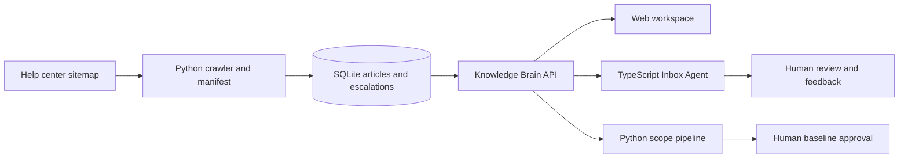

# Design notes

## What the app is for

Small support teams often repeat the same work: look up product instructions, write a customer reply, and turn a loose meeting into a project plan. This demo puts those three jobs in one workspace. The Knowledge Brain is the shared source for the reply and planning workflows, so each can show where its product information came from.

## How the pieces fit together

The Knowledge Brain handles article imports, retrieval, citations, and unanswered-question escalations. The Inbox Agent sends a question to the Knowledge Brain and prepares a reply draft. The scope workflow checks feasibility against the same knowledge source, extracts requirements, estimates effort, and compares later meeting notes with an approved baseline.

Knowledge articles and escalations are stored in SQLite. Inbox feedback is kept in a local JSONL journal. Scope drafts and approvals currently live in the Python process, so they are lost when that process stops. A production version should move all three records into a shared database with an audit trail.

## Why it is built this way

- **Python, FastAPI, and Pydantic** provide the Knowledge Brain and scope APIs, typed request validation, and browsable API documentation.
- **SQLite** keeps the demo easy to start without a separate database service. Retrieval currently uses word overlap. It is easy to inspect, but it is not as capable as a tested hybrid search system with embeddings.
- **TypeScript and Node.js** keep email fields and feedback events structured. Replies remain drafts. Twenty consecutive unchanged approvals can make low-risk how-to drafts eligible for a future autonomy step, but no email sending or automatic reply is connected.
- **Evidence and review** are central to the workflow. Weak search results lead to a human review task. Refund decisions, pricing, and delivery dates need account-specific confirmation.
- **One responsive web page** gives access to all three workflows and displays service errors where a user can see them.
- **Live public help, local cache.** The Knowledge Brain imports the public help-center sitemap on startup and on request, then stores the article text in SQLite for search. Inbox and Scope call the local Knowledge Brain API. Private customer-site API access is not configured because each site requires its own credentials.
- **Claude is not connected yet.** The assignment calls for Claude, but this local version has no provider integration or model run. Do not present its rule-based output as Claude output.

## What works and what remains

The demo includes a checkpointed sitemap crawler, nested sitemap expansion, rotating daily batches, content hashes, article parsing, citations, unanswered-question escalation, expert answer review, email classification and drafting, a feedback streak, basic transcript extraction, feasibility checks, estimates, project approval, follow-up comparison, and synthetic fixtures.

The crawler expands nested sitemaps up to a safety limit and captures image references and alt text. It does not download images or generate descriptions with a vision model. Large sitemaps take multiple days at the default batch size. This version also lacks embeddings, API authentication, durable project history, a live email connection, Claude generation, and recorded client role-play transcripts.

## Risks and next steps

The local APIs have no authentication and should only be used for this loopback demo. The crawler waits 250 milliseconds between requests; check the help center's access rules before a larger crawl. The scope extractor is a simple rule-based baseline and can miss implied requirements. Its estimates are planning aids, not quotes.

Before production use, add authentication, durable audit records, integration tests, injection-focused evaluations, nested sitemap support, image processing, and human-reviewed model results. Measure retrieval and draft quality before choosing a more complex search or generation setup.
